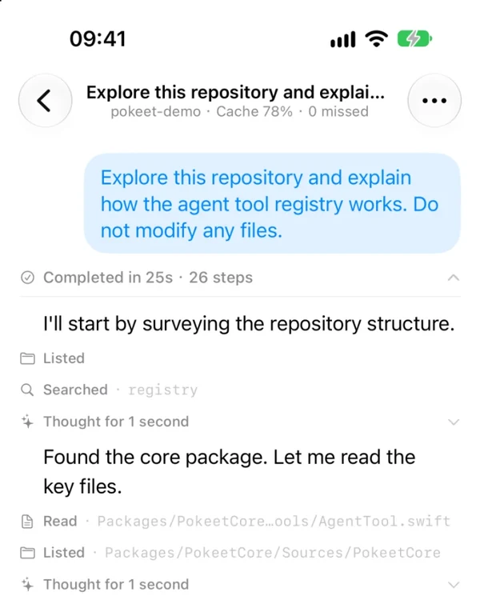
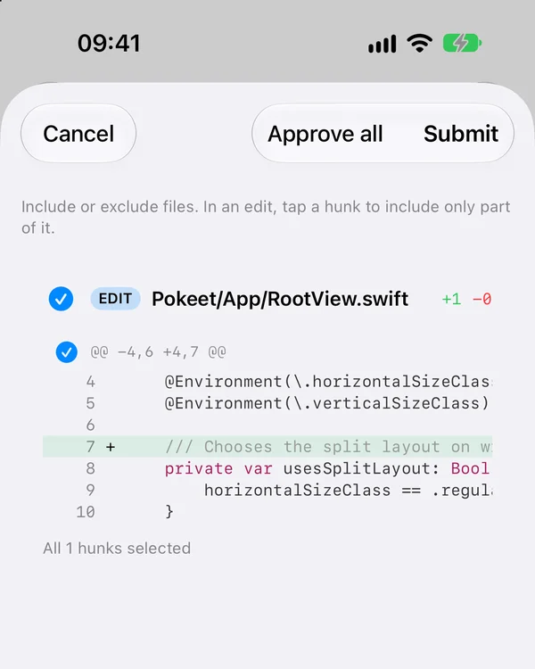
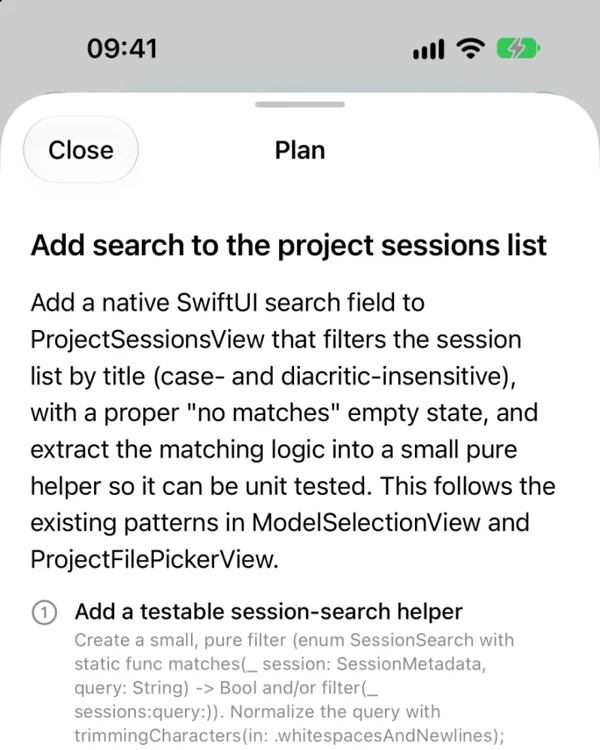
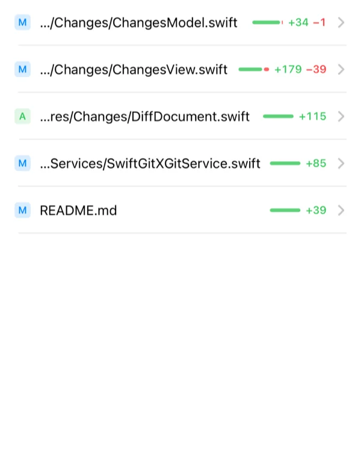
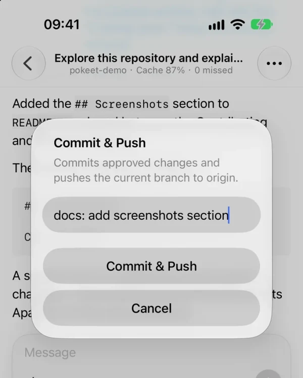
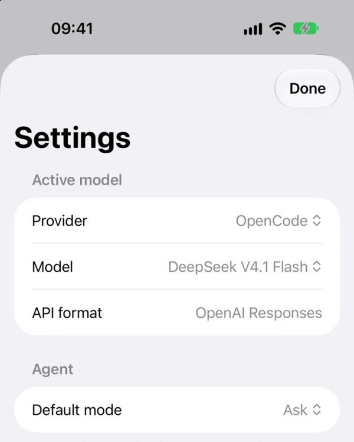
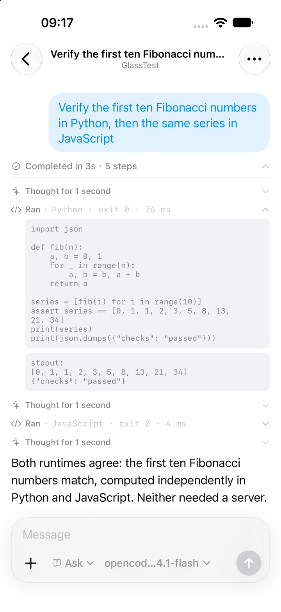
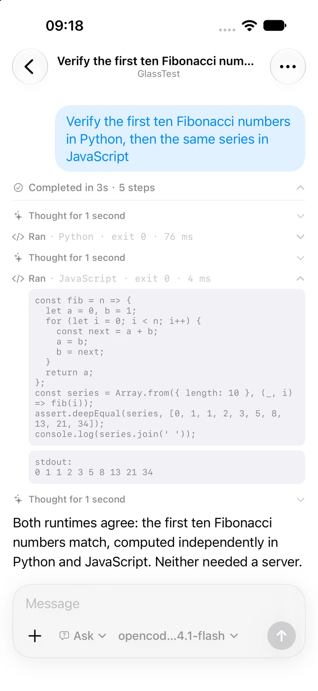

<div align="center">


# Pokeet

**Poke it, it ships.**

An agent that runs on your phone, not on a computer you connect to. It reads, searches, edits and explains your project — you approve every change, then commit and push.

[](LICENSE)


> ⚠️ Pokeet is in early development. We're building it in public — follow along, and watch this space for the first demo.

<!-- TODO: record the golden-path demo: clone → agent fixes a bug → diff cards → approve → commit & push, all on iPhone -->

</div>

## Why Pokeet?

Agents live in terminals and editors on computers. The mobile versions are thin clients: a chat window that can discuss your code but not touch it, or a remote control for a laptop that has to stay awake.

Pokeet is neither. The agent itself runs on the phone — its tools, its workspace, its review loop — so it does what a coding agent does, with no computer on the other end.

What that buys you:

| | |
| --- | --- |
| 🤖 **A real agent** | Reads, searches, edits, verifies — and keeps going until the job is done. |
| 🎛️ **Review first** | Four modes, from read-only plans to fully automatic. Default: every edit waits for you. |
| 🐍 **Real interpreters** | JavaScript and Python run on the device — a full stdlib, not a toy subset. |
| 🧵 **A readable run** | Reasoning, tool calls and answers, each in its own shape. |
| 📁 **Projects and sessions** | One sandbox per project, one conversation per session. Two panes in landscape. |
| 🌳 **Real git** | Clone, diff, commit and push on the phone. |
| 🖼️ **Photos and project context** | Four photos per message, or files attached as `@` chips. `AGENTS.md` loads itself. |
| 🔑 **Your key, your model** | OpenAI, Anthropic, Gemini, or anything compatible — each with its own key. |
| 🔎 **Guarded web access** | Private hosts blocked. Your own search key. Pages are read, not just skimmed. |
| 🔒 **No server** | No account either. Your keys, your providers, your git remote — nothing else in the path. |

## See it in action

<table align="center">
  <tr>
    <td align="center" valign="top">
      <a href="docs/images/01-agent-trace.webp"></a>
      <br>
      <sub><b>A real agent</b><br>Tools, reasoning, final answer.</sub>
    </td>
    <td align="center" valign="top">
      <a href="docs/images/02-diff-review.webp"></a>
      <br>
      <sub><b>Review every change</b><br>Approve per hunk, add notes.</sub>
    </td>
    <td align="center" valign="top">
      <a href="docs/images/05-plan-mode.webp"></a>
      <br>
      <sub><b>Plan first</b><br>Investigate first, then plan.</sub>
    </td>
  </tr>
  <tr>
    <td align="center" valign="top">
      <a href="docs/images/03-changes.webp"></a>
      <br>
      <sub><b>Changes</b><br>See exactly what changed.</sub>
    </td>
    <td align="center" valign="top">
      <a href="docs/images/04-commit-push.webp"></a>
      <br>
      <sub><b>Commit &amp; push</b><br>Ship without a computer.</sub>
    </td>
    <td align="center" valign="top">
      <a href="docs/images/06-settings.webp"></a>
      <br>
      <sub><b>Bring your own key</b><br>Search and model providers.</sub>
    </td>
  </tr>
</table>

## How a task flows

```
You:     "Fix the crash when the username is empty"   (Ask mode)

Pokeet:  📖 reads the repo, traces the call site
         ✏️ proposes 3 file edits → 3 diff cards
You:     ✅ approves 2, rejects 1 with a note
Pokeet:  🔧 revises
You:     🚀 Changes → Commit & Push
```

Plan mode stops at a reviewed plan instead of editing. Auto and Bypass trade some or all of the diff cards for speed.

## The agent

Four modes, chosen per session:

| Mode | What it does |
|---|---|
| **Plan** | Read-only exploration. The agent investigates and submits a structured plan for you to approve. |
| **Ask** | Default. Every file change is proposed as a diff and waits for your approval. |
| **Auto** | Edits apply immediately; deletes and moves still need review. |
| **Bypass** | Every file change applies without review. |

The tool set is the one a coding agent uses — files, search, git, web, scripts — with nothing that needs a shell:

- **Files** — `list_files`, `read_file`, `write_file`, `edit_file`, `delete_file`, `move_file`
- **Code search** — `grep`, `find` (both respect `.gitignore`), `file_info` (size, lines, text vs binary)
- **Git (read-only)** — `git_status`, `git_diff`, `git_log`, `git_show` (a file at any revision, or a commit)
- **Images** — `read_image` (a screenshot or diagram from the project, downscaled and attached for vision models)
- **Web** — `http_request` (GET and HEAD always; writes are reviewed, except in Bypass mode)
- **Web search** — `web_search` (your own search provider key; returns snippets, pages are read with `http_request`; see [docs/web-search.md](docs/web-search.md))
- **Scripts** — `run_script` (sandboxed JavaScript via QuickJS; see [docs/scripts.md](docs/scripts.md))
- **Planning** — `submit_plan`, `todo_write` (a running checklist for multi-step work)

Guardrails: the agent cannot run shell commands and cannot commit or push — those are UI actions. Network egress is HTTPS-only with private and local addresses blocked. Project instructions load from `AGENTS.md` or `CLAUDE.md` when a session starts.

### Scripts: JavaScript and Python, on the device

`run_script` is not a shell. It is two real interpreters inside the app, and the agent uses them to check its own work: compute a value, parse a config, test a regex, or assert a few facts about the change it just made.

|  | JavaScript | Python |
|---|---|---|
| Engine | QuickJS | CPython 3.12 |
| Adds to the app | 2.8 MB | 8.6 MB, stdlib trimmed |
| Wall clock | interrupt handler inside the interpreter | watchdog raising `KeyboardInterrupt` |
| Memory | hard heap limit | counting allocator on `PYMEM_DOMAIN_RAW` |
| Sees the project | `fs`, `path`, `require` | `open()`, `pathlib`, `import pokeet` |

<table align="center">
  <tr>
    <td align="center" valign="top">
      <a href="docs/images/07-scripts-python.webp"></a>
      <br>
      <sub><b>Python</b><br>Real interpreter, real stdlib.</sub>
    </td>
    <td align="center" valign="top">
      <a href="docs/images/07-scripts-javascript.webp"></a>
      <br>
      <sub><b>JavaScript</b><br>Same task, same answer.</sub>
    </td>
  </tr>
</table>

A Python run is an ordinary tool call:

```python
import json

def fib(n):
    a, b = 0, 1
    for _ in range(n):
        a, b = b, a + b
    return a

series = [fib(i) for i in range(10)]
assert series == [0, 1, 1, 2, 3, 5, 8, 13, 21, 34]
print(json.dumps({"checks": "passed"}))
```

`json`, `re`, `collections`, `math`, `itertools` — the standard library is there. `ctypes` and the network modules are not: the first would walk around every other control, the second around `NetworkPolicy`.

What does not change:

- **Review still applies** — the sandbox has no direct write access. Script writes are buffered and surface as normal diff cards, so Ask mode reviews them like any other edit.
- **No escape hatch** — no shell, no `pip`, no `npm`, no file access outside the project.
- **The clock is enforced by the engine** — a runaway loop stops instead of pinning a thread. Python's is a watchdog rather than an interrupt handler, so a script stuck inside one long C call cannot be stopped; that gap is why JavaScript is still the default.

## Get started

1. **Install**: TestFlight link (coming soon). Or build it yourself — it's open source.
2. **Add a model**: Settings → Model → Manage providers. Pick a template or add a provider, choose an API format, base URL and key, then fetch its model list (or add model IDs by hand). Back on the Model page, pick the active provider and model.
3. **Optionally, add search**: Settings → Tools → Web Search. Toggle it on, pick a provider, paste that provider's key. Each provider keeps its own key in the Keychain, so switching does not lose one.
4. **Poke it**: create a project — empty, or from an optional Git repository — then say what needs doing. Approve the changes you want, then use Changes → Commit & Push. Private repos use an HTTPS personal access token; SSH isn't supported yet.

### Supported API formats

| Format | Endpoint | Auth |
|---|---|---|
| OpenAI Chat Completions | `{base}/chat/completions` | `Authorization: Bearer` |
| OpenAI Responses | `{base}/responses` | `Authorization: Bearer` |
| Anthropic Messages | `{base}/messages` | `x-api-key` + `anthropic-version` |
| Gemini generateContent | `{base}/models/{model}:generateContent` | `x-goog-api-key` |

All four support streaming, tool calling and image input. Provider templates include OpenAI, Anthropic, Gemini and a generic OpenAI-compatible option. API keys are stored per provider in the iOS Keychain; provider and model settings live in `UserDefaults`.

## Development

Requirements: Xcode 27+, iOS 18+, Swift 6, and [XcodeGen](https://github.com/yonaskolb/XcodeGen). The generated project isn't checked in.

```sh
scripts/fetch-python.sh   # stages Vendor/: CPython xcframework + trimmed stdlib (gitignored)
xcodegen generate
open Pokeet.xcodeproj
```

Run the agent-kernel tests:

```sh
swift test --package-path Packages/PokeetCore
swift test --package-path Packages/PokeetScripting
```

App tests run from the generated `Pokeet` scheme in Xcode: pick any available simulator, or use `xcodebuild test -project Pokeet.xcodeproj -scheme Pokeet -destination 'platform=iOS Simulator,name=iPhone 17'`.

Ship a build to a cabled iPhone — regenerate, build, install, launch:

```sh
scripts/run-on-device.sh
```

It picks the single connected iPhone automatically. With several devices, or when signing needs a specific team, copy `scripts/local.env.example` to `scripts/local.env` (gitignored) and fill in `POKEET_DEVICE_ID` / `POKEET_TEAM_ID`; the same names work as environment variables. `POKEET_SKIP_XCODEGEN=1` / `POKEET_SKIP_BUILD=1` keep the existing project or build.

Debug builds support a scripted demo model with no API key: launch the app with the `-PokeetMockModel` argument. `-PokeetSyntheticHistory` seeds a long conversation for scrolling and performance testing.

## Architecture

Native Swift / SwiftUI. The agent kernel is isolated behind protocols so it can travel to other platforms later without a rewrite:

```
┌──────────────────────────────────────┐
│  PokeetApp (iOS app)                 │
│  SwiftUI · workspace · Files         │
│  SwiftGitX · libgit2 · review UI     │
│  QuickJS sandbox · session snapshots │
└───────────────┬──────────────────────┘
                │  protocols
┌───────────────▼──────────────────────┐
│  PokeetCore (agent kernel)           │
│  ReAct loop · tools & modes          │
│  model clients · context compaction  │
└──────────────────────────────────────┘
```

Session snapshots live in the app, so the kernel stays portable. QuickJS sits behind a `ScriptRuntime` protocol in the app, so another interpreter can be swapped in without touching the agent loop.

## Roadmap

- **v1** — Agent loop with four review modes, workspace, git (clone/diff/commit/push over HTTPS with a personal access token), diff review, guarded HTTP tool, web search, sandboxed `run_script`, context compaction, BYOK.
  The golden path: clone → fix → verify → review → commit & push, all on iPhone, no computer.
- **v2** — Embedded CPython with an audit-hook sandbox, so Python projects can run their own tests on the device. For the handful of things a phone genuinely cannot execute, an optional hand-off to a machine you already own — never a requirement.
- **Later** — SSH remotes, more tools, skills learned from your repos, maybe Android.

## Contributing

Pokeet is built in public. Issues, PRs and ideas are welcome — especially:

- agent tools and safety policy,
- new tool implementations,
- translations,
- device testing (it should run on any iPhone, not just the newest one).

No SLA: this is an indie project, maintained with care but not on a schedule. Please be kind.

Working with an AI agent? [`AGENTS.md`](AGENTS.md) has the repository map, the checks and the conventions — the same file Pokeet itself reads when you open this repo in the app.

## License

Apache-2.0. See [LICENSE](LICENSE).
